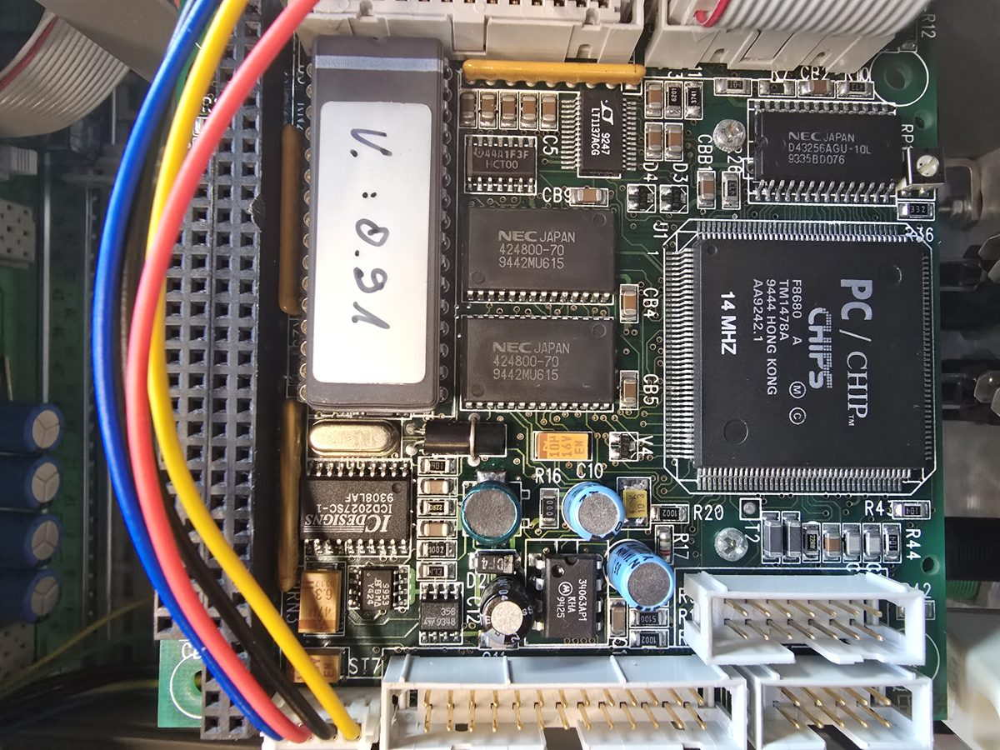

# Bender UNIMET 1000 ST — teardown & reverse engineering


Repair and reverse-engineering notes for a **Bender UNIMET® 1000 ST** electrical
safety tester for medical devices (IEC 62353 / DIN VDE 0751, built ~1995):
BIOS dump analysis, RS-232 command set (SCPI-style, 427 test steps, 493 commands),
I²C relay matrix, connector pinouts of the F8680 PC/CHIP CPU module.



> Detailed documentation is in German. Manufacturer manuals, firmware and
> software are **not** included (copyright) — see [`QUELLEN.md`](QUELLEN.md)
> for where to get them.

## Summary (English)

**Status: closed (2026-07-31). The device was not restored.**

- **Boot failure — solved.** The unit looped on `Using defaults for system
  configuration` / `Diskette error`. Causes: a stuck key in the front-panel
  matrix kept acknowledging every "Press any key", and the boot medium — a
  PCMCIA flash card holding MS-DOS 5.0 and `UNIMET.EXE` — was missing.
- **Platform:** PC/104-style CPU module `B170X4` with a **Chips & Technologies
  F8680 "PC/CHIP"** (XT-class, 14 MHz), BIOS in a socketed `NM27C010` EPROM,
  `A104-MIO` multi-I/O board. *(Not a Kontron MOPS/386A, as an online forum
  thread suggested.)*
- **Why it stays dead:** the **measurement card is missing**. It carried the
  whole analog measuring chain, the mains switching (L/N, phase reversal,
  open conductor) and the pass-through of the I²C bus. It is a Bender-specific
  part with no known source.
- **The unit had been deliberately converted** before it was sold: milled trace
  cuts, rear connectors removed, RS-232 disabled — turned into a display
  terminal for a Bender RS-485 bus, as a rear label states.
- **What is documented:** BIOS setup structure and boot messages, the full
  RS-232 command and test-step reference, the I²C relay matrix (`PCF8574` at
  `0x24`/`0x25`, partially mapped), the pinout of every CPU-module connector.

If you have a **complete** UNIMET 1000 ST / 1100 ST, most of this applies to
your unit as well — especially the command set and the boot troubleshooting.

## Tools

```sh
# Regenerate research/RS232_PROTOKOLL.md from the Bender interface manual
# (needs pdftotext and docs/bender/UNIMET_Interface_Handbuch_de.pdf, see QUELLEN.md)
python tools/parse_interface.py
```

`tools/xt_keyboard/xt_keyboard.ino` — Arduino sketch (5 V board) that emulates
an XT keyboard on the F8680's `KBCLK`/`KBDATA` pins, taking scancodes from the
serial console. Wiring is in the sketch header.

---

# Deutsch

Unterlagensammlung und Reparaturdokumentation zu einem gebraucht erworbenen
Bender UNIMET® 1000 ST (Prüfsystem für die elektrische Sicherheit medizinischer
elektrischer Geräte, IEC 62353 / DIN VDE 0751).

## Status: abgeschlossen (2026-07-31)

Das Gerät wurde **nicht** wiederhergestellt. Grund ist nicht der ursprüngliche
Bootfehler — der war vollständig aufgeklärt —, sondern ein Befund, der erst bei
der Untersuchung der Baugruppen auftauchte:

**Die Messeinrichtung fehlt.** Auf der ausgebauten Steckkarte saßen die
gesamte Messkette, die Netzschaltung (L, N, Phasenlage, Netzleiter-Unterbrechung)
und der Durchlauf des I²C-Bus. Ohne sie ist das Gerät ein Rechner mit Anzeige
und Schaltmatrix.

**Und das Gerät wurde vor dem Verkauf umgebaut**, nicht ausgeschlachtet: gezielt
gefräste Leiterbahnunterbrechungen, entfernte Rückwandanschlüsse, stillgelegte
RS-232 — zu einem **Anzeigeterminal für einen Bender-RS-485-Bus**, wie der
Rückwandaufkleber es benennt. `UNIMET.EXE` war zuletzt gar nicht mehr installiert.

Alles andere wäre rekonstruierbar gewesen: BIOS gedumpt und verstanden, Display
ansteuerbar, Relaismatrix über I²C entschlüsselt, Befehlssatz dokumentiert.
Nur der analoge Messkopf war unersetzlich.

Das Gehäuse wird weiterverwendet.

---

**Ausgangslage:** Gerät bootete nicht — `Using defaults for system configuration`
und `Diskette error` in Endlosschleife.

## Wo was steht

| Datei | Inhalt |
|---|---|
| **`research/STAND.md`** | **Arbeitsstand und abschließende Deutung. Hier anfangen.** |
| **`research/EPROM_ANALYSE.md`** | BIOS-Dump ausgewertet: Setup-Struktur, Bootmeldungen, Reparaturweg |
| **`research/EINGANGSPRUEFUNG.md`** | Checkliste zur Erstinbetriebnahme |
| **`research/BEFUNDE.md`** | Fehlerdiagnose, Reparaturweg, Fallen, Suche nach dem OS-Image |
| **`research/MESSTECHNIK.md`** | Prüfhardware: technische Daten, rekonstruierte Relaistopologie, Nachbau-Einschätzung |
| **`research/RS232_PROTOKOLL.md`** | Vollständige Schnittstellenreferenz: 427 Prüfschritte, 493 Befehle, Protokoll, Verkabelung |
| **`research/RELAISMATRIX.md`** | Relaisplatine: I²C-Ansteuerung und Bitbelegung (unvollständig kartiert) |
| **`research/ANSCHLUESSE.md`** | Anschlussbelegung aller Steckverbinder des CPU-Moduls, Prozessor-Pins, Display-Daten und -Versorgung |
| `research/UEBERTRAGER.md` | Bauteilcharakterisierung des ausgelöteten Übertragers `BG160 805 Q3995` (Nachuntersuchung) |
| `tools/parse_interface.py` | erzeugt die RS232-Referenz aus dem Interface-Handbuch neu |
| `tools/xt_keyboard/` | Arduino-Sketch: XT-Tastatur-Emulator am F8680, Scancodes über die serielle Konsole |
| `bilder/` | eigene Fotos der Baugruppen |
| [`QUELLEN.md`](QUELLEN.md) | Bezugsquellen aller Herstellerunterlagen |

**Nur lokal, nicht veröffentlicht** (urheberrechtlich geschützt bzw. fremde
Inhalte — die Bezugsquellen stehen in `QUELLEN.md`):

| Pfad | Inhalt |
|---|---|
| `firmware/` | ausgelesenes BIOS-EPROM (NM27C010, `V: 0.91`) |
| `docs/bender/` | Bender-/BENTRON-Handbücher (1000ST/1100ST, Interface, UNIData1100, 300ST, 800ST/810ST) |
| `docs/kontron/`, `docs/diskonchip/` | Kontron MOPS/386A, M-Systems DiskOnChip — für dieses Gerät gegenstandslos |
| `software/` | `SSDINIT.EXE`, JIDA-Treiber, `Unimet300_V110.exe` |
| `research/text/` | alle PDFs als durchsuchbarer Text (`pdftotext -layout`) |
| `research/threads/` | Archivkopie des Forenthreads [mikrocontroller.net/topic/566576](https://www.mikrocontroller.net/topic/566576) |

## Kurzfassung des Befunds

Im Gerät steckt ein CPU-Modul `B170X4` mit **Chips & Technologies F8680
„PC/CHIP"** (XT-Klasse, 14 MHz), BIOS im gesockelten EPROM `NM27C010`, dazu
eine Multi-I/O-Karte `A104-MIO`. Bootmedium war eine **PCMCIA-Flash-Karte** mit
MS-DOS 5.0 und `UNIMET.EXE` — sie fehlt.

Der Bootfehler hatte zwei Ursachen: die fehlende Karte (kein Bootmedium,
Rückfall auf Diskette) und eine **klemmende Fronttaste**, die jedes
„Press any key" sofort quittierte und damit auch den Weg ins BIOS-Setup
versperrte. Details in `research/STAND.md` und `research/BEFUNDE.md`.

> **Widerrufen (2026-07-30):** Eine frühere Fassung dieser Kurzfassung nannte
> ein Kontron MOPS/386A (386SX) mit verlöteter Silicon-Disk. Das stammte aus
> einem Forenthread und trifft auf dieses Gerät nicht zu. Die Hinweise zu
> `Erase On Next Boot` und FDISK auf der Silicon-Disk gelten nur für
> UNIMET-Baujahre mit MOPS-Board.

## ⚠️ Sicherheit

- Netzstecker ziehen vor dem Öffnen — das Gerät erzeugt 500 V DC für die
  Isolationsprüfung und schaltet Netzspannung auf Prüfkreise.
- **`UNIMET.EXE` ist nirgends öffentlich verfügbar.** Wer ein vollständiges
  Gerät hat: zuerst das Bootmedium sichern, vor jedem anderen Eingriff.
