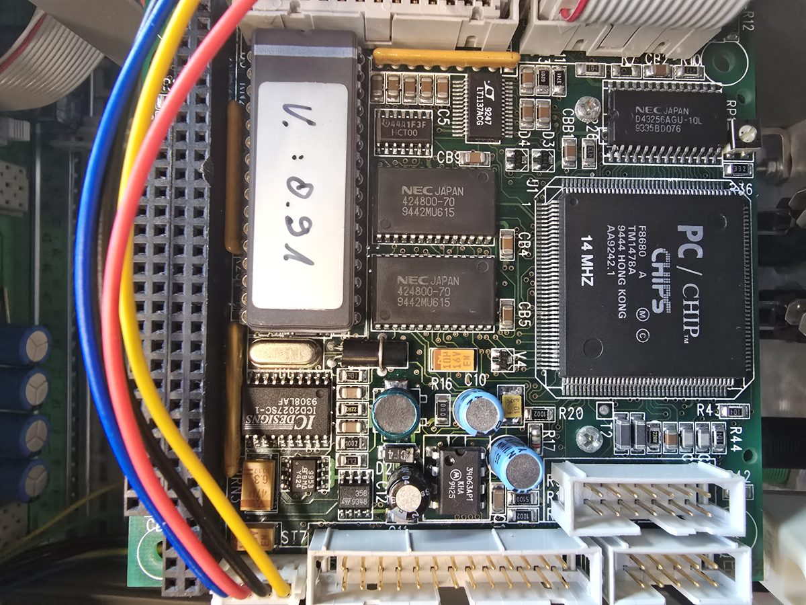

Repair and reverse-engineering notes for a **Bender UNIMET® 1000 ST** electrical
safety tester for medical devices (IEC 62353 / DIN VDE 0751, built ~1995).
Much of it also applies to the **UNIMET 1100 ST**.

## What you will find here

- **Boot troubleshooting** — `Using defaults for system configuration` and a
  looping `Diskette error`: causes and the way into the BIOS setup
- **RS-232 command set** — interface parameters (9600 baud, 7E2, null modem),
  protocol, 427 test steps and 493 commands of the UNIMET 1000/1100 ST
- **I²C relay matrix** — `PCF8574` port expanders at `0x24`/`0x25` driving the
  relay board (partially mapped)
- **Connector pinouts** of the CPU module (Chips & Technologies F8680 "PC/CHIP",
  XT class, 14 MHz) and the display
- **BIOS dump analysis** of the `NM27C010` EPROM, version `V: 0.91`

## The short story

The unit arrived not booting. The boot failure was fully explained — a stuck
front-panel key and a missing PCMCIA flash card that held MS-DOS 5.0 and
`UNIMET.EXE`. But the **measurement card was missing** too: the analog
measuring chain and the mains switching sat on it, and it is a Bender-specific
part. The unit had also been deliberately converted into a display terminal
for a Bender RS-485 bus before it was sold. The project was closed on
2026-07-31 without restoring the device.

## Documents (German)

| Document | Content |
|---|---|
| [Status & final interpretation](research/STAND.md) | start here |
| [Findings](research/BEFUNDE.md) | fault diagnosis, pitfalls, search for the OS image |
| [BIOS analysis](research/EPROM_ANALYSE.md) | setup structure, boot messages |
| [RS-232 reference](research/RS232_PROTOKOLL.md) | full command set and test steps |
| [Relay matrix](research/RELAISMATRIX.md) | I²C control and bit assignment |
| [Connectors](research/ANSCHLUESSE.md) | pinouts of all CPU-module connectors |
| [Measurement hardware](research/MESSTECHNIK.md) | specs, reconstructed relay topology |
| [Incoming inspection](research/EINGANGSPRUEFUNG.md) | first power-up checklist |
| [Transformer](research/UEBERTRAGER.md) | characterisation of `BG160 805 Q3995` |
| [Sources](QUELLEN.md) | where to get the manufacturer manuals |

Manufacturer manuals, firmware and software are not published here (copyright).

Source and photos: [github.com/feiglein74/bender-unimet-1000st](https://github.com/feiglein74/bender-unimet-1000st) ·
License: CC BY-SA 4.0 for own content, see [LICENSE](LICENSE.md).
